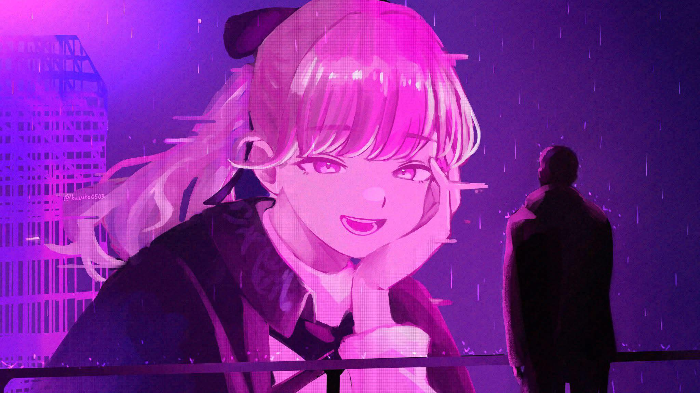

<div align="center">




<p>
  
  
</p>

<a href="https://www.facebook.com/share/v/1RZkcgbQqU/?mibextid=wwXIfr"></a>
<a href="https://www.instagram.com/reel/DA6BQcERa2e/?igsh=NjZxM2Y2M2M0MTJ6"></a>
<a href="https://youtube.com/shorts/DiWI6q0Jxpk?si=xNu-ro4k3ypWg6Sp"></a>
<a href="mailto:farisarthan@gmail.com"></a>

</div>


## 🧑‍💻 `$ whoami`

```ts
const faris = {
  name:      "Faris Ajhan",
  nickname:  "โค้ค (Coke)",
  role:      "Full-Stack Web Developer",
  location:  "🇹🇭 Thailand",
  stack:     ["Next.js", "TypeScript", "React", "Go", "PHP", "Supabase"],
  styling:   ["Tailwind CSS", "shadcn/ui"],
  database:  ["PostgreSQL", "MySQL"],
  creative:  ["Photoshop", "Illustrator", "Premiere Pro", "After Effects"],
  motto:     "ความรักคืออะไร ความรักก็คือข้าวมันไก่ 🍗",
  status:    "🟢 Open to work & freelance",
};
```


## ⚙️ Tech Stack

<div align="center">

**🚀 Languages**


**🧩 Frameworks & Runtime**


**🗄️ Database & DevOps**


**🎨 Design & Creative**


</div>


</div>
